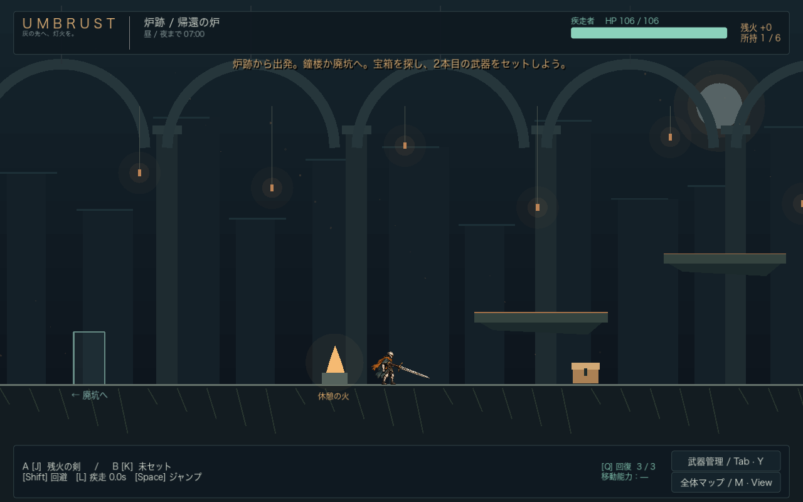
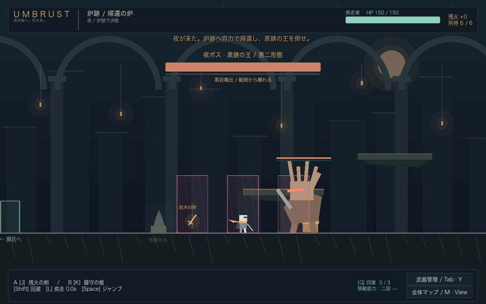

# UMBRUST — アンブラスト

黒錆が迫る土地を探索し、最大6本の武器でビルドを作って夜のボスに挑む、Godot 4.6.3製の2Dアクション試作です。外部アセットやアドオンのインストールは不要です。

現在は **v0.2 戦闘拡張版**。剣の三連撃、槍の穂先補正、斧による体勢崩し、盾持ちの防御、ボス固有技と第二形態、命中時の打撃演出を追加しました。[変更内容と検証](docs/combat-v0.2.md)

疾走者の専用アートも追加しました。イメージイラスト、16ポーズの透過キャラクターアトラス、剣・槍・斧の素材をゲームに組み込んでいます。[素材一覧・使い方](docs/art/runner-v1.md) / 素材プレビューは `scenes/art_preview.tscn` をF6で実行。



[出発準備](docs/screenshots/preparation-runner-v1.png) · [6本の武器比較](docs/screenshots/inventory.png) · [疾走者の素材プレビュー](docs/screenshots/runner-art-v1.png)



## 起動

1. Godot 4.6.3で `project.godot` をインポートして開きます。
2. **F6ではなくF5**（プロジェクトを実行）で起動します。
3. 初期武器・永続効果を選び「探索に出発する」を押します。

通常は探索7分。4分で黒錆予告、5分から外側の部屋が侵食され、7分で夜になります。夜は炉跡に自力で戻ると決戦開始。ボス戦の制限時間はありません。

**短縮テスト**は時計だけが6倍速で進み、70秒で夜になります。攻撃・移動・侵食ダメージの実時間は変わりません。まず一周の流れを確かめる場合に使ってください。

## 操作

| 操作 | キーボード | ゲームパッド（Xbox名 / PlayStation相当） |
| --- | --- | --- |
| 左右移動 | A / D | 左スティック |
| ジャンプ | Space | A / × |
| 武器A | J | RB / R1 |
| 武器B | K | LB / L1 |
| 回避・攻撃の後隙キャンセル | Shift | B / ○ |
| 回復 | Q | 十字キー上 |
| 調べる・拾う・出口を使う | E | X / □ |
| 武器管理 | Tab | Y / △ |
| 全体マップ | M | View / Share |
| 疾走者の固有ステップ | L | 右スティック押し込み |
| 操作設定 | Esc | Menu / Options |

メニューは矢印キー＋Enter、マウス、パッドで操作できます。WASDはメニュー操作に使用しません。操作設定でゲーム中のキー・パッドボタン・スティック軸を変更し、保存できます。画面下の一部の案内は初期配置を表示します。

武器管理は**横3列×縦2段の6枠**です。**左上が武器A、左下が武器B**で、残りの4枠も付与効果が有効です。矢印キーで枠を選び、Enterで持ち上げ、移動先でEnterを押すと入れ替えます。空き枠へ移動することもできます。マウスでは2つの枠を順にクリックします。Escで入れ替えを取り消し、Tabで画面を閉じます。拾得・交換・廃棄は右側のボタンで決定します。

**武器管理中もA/Dまたは左スティックで左右移動できます。** パッドの枠選択は十字キー、決定はAです。攻撃・ジャンプ・回避・回復は画面を閉じてから行います。全体マップ・設定画面ではキャラクター入力をUIに切り替えます。すべての画面で時間、敵、黒錆は止まりません。

## 最初の探索

- 炉跡の宝箱を開き、出現した武器をもう一度Eで調べます。比較画面で「武器を拾う」を押すと取得。2本目は自動でBにセットされます。
- 左は廃坑、右は鐘楼。Mで全体マップ・付与傾向・侵食状態を確認できます。
- 鐘楼の上層へは足場を順にジャンプ。高い書庫の入口だけは二段ジャンプが必要です。
- 廃坑の宝物庫は、壁破壊の付与を持って黒岩を攻撃すると開きます。
- 6本所持時は番号ボタンで交換対象を選択し、右側の性能差・失う能力を確認して交換します。A/Bボタンで攻撃用セットを変更できます。
- 中ボスはアンコモン、鐘楼の任意の強ボスはレアを確定で落とします。
- 休憩の火に触れると全回復・回復回数補充。侵食後や夜ボス戦中は利用できません。
- 夜に炉跡へ戻ると、決戦直前に一度全補充されます。敵の赤い予兆を見て、回避しながら攻撃してください。

## v0.2の戦闘のコツ

- 剣は同じボタンで三連撃。三段目は威力と体勢へのダメージが増えます。攻撃が終わる直前に次のボタンを押すと、終了後に続けて攻撃します。
- 槍は長く細い突き。先端付近を当てると威力が20%増え、`TIP`と表示されます。
- 斧は重い一撃。盾の防御を貫き、敵の緑色の体勢ゲージを大きく削ります。ゲージが満ちると`BREAK`となり、1.25秒の隙と与ダメージ20%増の好機が生まれます。
- 盾持ちは正面の軽い攻撃を軽減します。背後に回る、攻撃後の隙を狙う、斧で崩す方法が有効です。
- 鐘守の衝撃波と坑夫の地砕きはジャンプ、黒岩噴出は予告された縦長の範囲から移動して避けます。ボスの技名はHPバーの下に表示します。
- 強ボス・夜ボスはHP50%以下で第二形態になり、攻撃の組み合わせが変わります。
- 画面揺れは設定で無効化できます。打撃の短い停止演出は攻撃した本人と被弾した敵だけに作用し、探索時計や他の敵を停止しません。

## 実装範囲

疾走者1人、3拠点・独立した10部屋、3武器種・3レアリティ、6本の所持と2本の攻撃セット、2枠の付与抽選、二段ジャンプ・壁破壊、3ステータス効果、雑魚3種・中ボス2体・強ボス1体・夜ボス1体、宝箱・休憩・回復上限増加、部屋単位の侵食、周回報酬・初期武器解放・永続補正を実装しています。

疾走者と装備は専用の透過PNGを使用し、背景・敵・演出はGodotの図形による仮グラフィック、効果音は生成音です。数値・敵の挙動・部屋の密度はプレイテストで調整する段階です。オンライン協力、ランダム生成、他の2キャラクター、背景・敵の専用アートとBGMは今回の試作範囲外です。パッドは入力マッピングを実装していますが、実機での操作感は未検証です。

仕様との対応と採用した仮数値は [docs/implementation.md](docs/implementation.md) を参照してください。

## セーブ

Godotの `user://profile.cfg` に欠片、解放武器、永続効果、初期武器の選択、キー設定を保存します。macOSの通常の保存先は `~/Library/Application Support/Godot/app_userdata/UMBRUST/` です。勝利・敗北・設定画面からの周回終了時に獲得通貨を持ち帰ります。プレイ中の強制終了は周回結果の保存対象外です。

## 構成と検証

| ファイル | 役割 |
| --- | --- |
| `scripts/game.gd` | 周回、昼夜、部屋移動、戦利品、報酬 |
| `scripts/player.gd` / `player_controls.gd` | プレイヤー単位の操作、所持品、戦闘、カメラ |
| `scripts/armory.gd` | 武器データ、付与抽選、加算上限 |
| `scripts/atlas.gd` / `room.gd` | 部屋接続、侵食時刻、地形・オブジェクト |
| `scenes/rooms/` | 独立した10部屋のシーン |
| `scripts/enemy.gd` / `combat_hazard.gd` | 固有攻撃、体勢、第二形態、予告付き衝撃波・黒岩 |
| `scripts/ui.gd` / `profile.gd` | 日本語UI、比較、地図、保存 |
| `tests/regression.gd` | 抽選制約、物理操作、戦闘、交換、侵食、周回、セーブの検証 |
| `tests/combat_checks.gd` | 連撃・入力受付、盾、体勢、範囲攻撃、第二形態の追加検証 |
| `scenes/visual_check.tscn` | 実描画の11画面を一時フォルダーへ出力 |

```sh
godot --headless --path . --editor --import --quit
godot --headless --path . --script res://tests/regression.gd
```

macOSでは `godot` を `/Applications/Godot.app/Contents/MacOS/Godot` に置き換えてください。テストのセーブは一時フォルダーへ分離し、通常のプレイデータを変更しません。

Godot MCPとNode.jsのローカル実行環境は `.tools/` に配置し、Git管理対象から除外しています。
